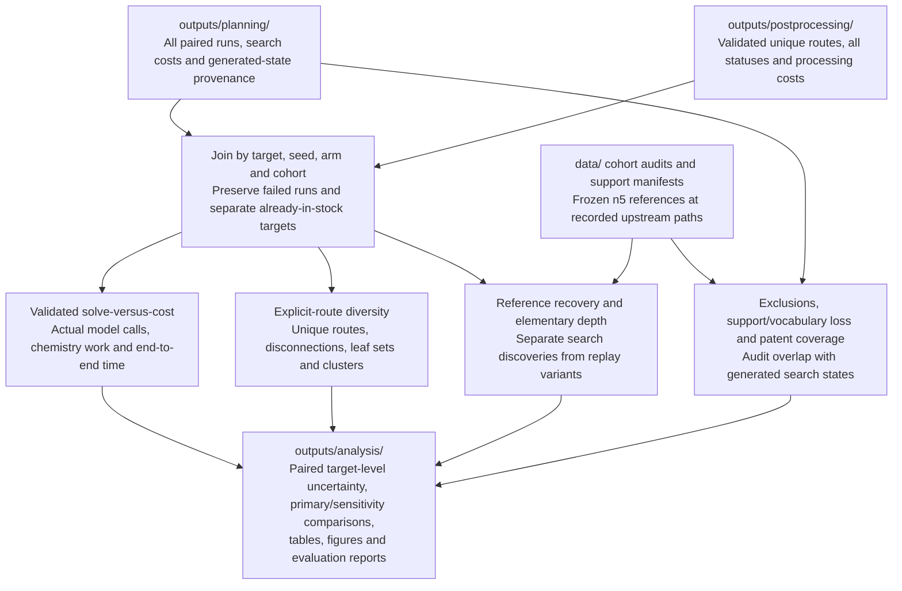

# Analysis workflow

This is the planned analysis stage. It consumes search records and validated
post-processing results; the analysis runner remains a TODO. See
[PLAN.md](../../PLAN.md#cost-validation-and-diversity).

Include unsuccessful runs and post-processing costs in comparisons. Count only
fully validated stock-reaching routes as solved, and report invalid/inconclusive
outcomes explicitly. Compare each hybrid with the shared single-step baseline
using paired n5 targets and seeds; report uncertainty at the target level.

The patent sensitivity report must show support and vocabulary losses alongside
planning outcomes. Search-generated overlap audits describe exposure without
revising frozen training exclusions. Keep reference recovery separate from route
diversity and preserve the provenance of replay-generated alternatives.

Write summaries and figures to [outputs/analysis/](../../outputs/README.md), with
links and hashes tracing each result to its planning, post-processing, and
preparation inputs. Upstream workflows: [planning](planning.md) and
[post-processing](postprocessing.md).
