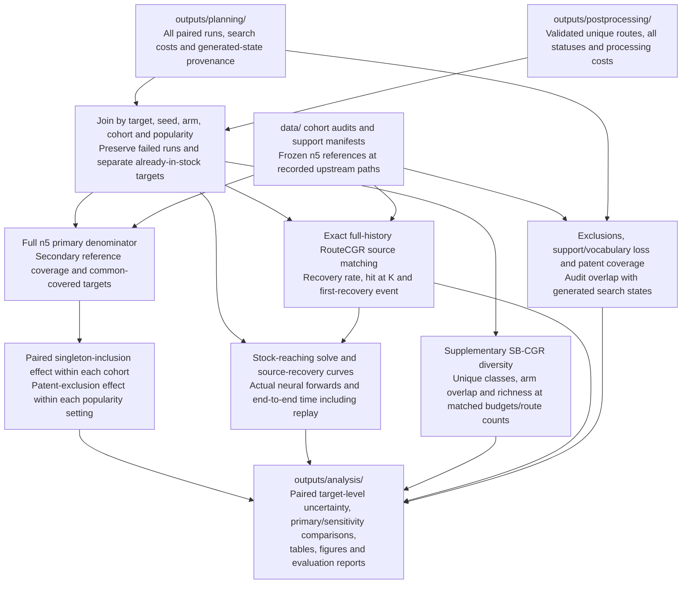

# Analysis workflow

This is the planned analysis stage. It consumes search records and validated
post-processing results; the analysis runner remains a TODO. See
[PLAN.md](../../PLAN.md#cost-validation-and-diversity) and the
[evaluation specifications](../EVALUATION.md).

Include unsuccessful runs and post-processing costs in comparisons. Record first
validated-solution and first-reference-recovery events; do not backdate them to
macro discovery before replay. Source matching is retrospective evaluation only.
SB-CGR diversity uses validated explicit routes and remains separate from exact
RouteCGR recovery; its offline analysis time is reported separately. Count only
fully validated stock-reaching routes as solved, and report invalid/inconclusive
outcomes explicitly. Compare each hybrid with the shared single-step baseline
using paired n5 targets and seeds; report uncertainty at the target level.

Use full n5, including no-tactic targets, for the main comparison. Recompute
reference coverage for each repertoire and report retained support, detected
linear tactics without retained support, and no detected linear tactics.
Use fixed/common-covered targets for direct subset comparisons; record actual
composite use separately without conditioning the main denominator on use.

Compare pop_gt1 with pop_ge1 within each cohort, and primary with patent-disjoint
within each popularity setting. Preserve both factor IDs in all reports. Show
pair, vocabulary and coverage losses alongside planning outcomes. Search-generated overlap audits describe exposure without
revising frozen training exclusions. Keep reference recovery separate from route
diversity and preserve the provenance of replay-generated alternatives.

Write summaries and figures to [outputs/analysis/](../../outputs/README.md), with
links and hashes tracing each result to its planning, post-processing, and
preparation inputs. Upstream workflows: [planning](planning.md) and
[post-processing](postprocessing.md).
