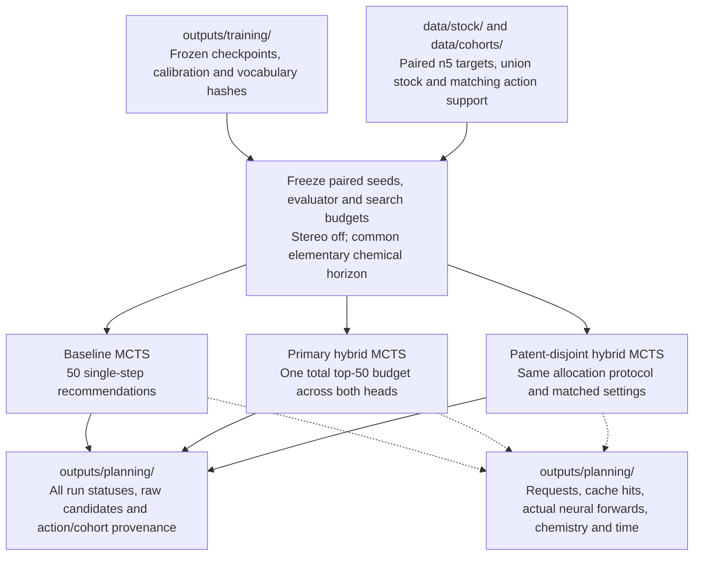

# Planning workflow

This is the planned MCTS experiment; the hybrid policy, search instrumentation,
and experiment runner remain TODOs. Planning produces candidate routes for
[post-processing](postprocessing.md). See [PLAN.md](../../PLAN.md).

All arms share the single-step checkpoint, targets, stock, and evaluator. Use
`stereo_mode: off` and `min_mol_size: 0`; record chemical depth separately from
macro-action depth. The hybrid allocation is still an open decision. Preserve
unsuccessful runs, timeouts, generated-state provenance, and already-in-stock
targets for analysis.

Candidate routes and search-reported solves are provisional until explicit
validation. Save raw search outputs under
[outputs/planning/](../../outputs/README.md), then pass candidates and their
manifests to [post-processing](postprocessing.md).
