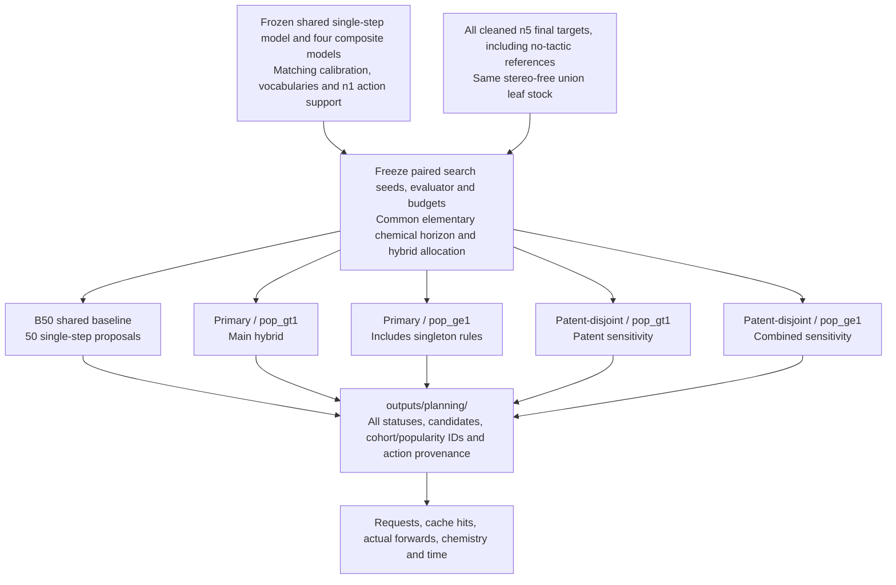

# Planning workflow

This is the planned MCTS experiment; the hybrid policy, instrumentation and
experiment runner remain TODOs. See the
[experiment matrix](../../PLAN.md#composite-popularity-experiment).

All four hybrids share one total top-50 budget; 40 single-step / 10 composite
slots remains a proposal. Do not use n5 reference-tactic annotations to select
targets or gate recommendations. The baseline is reused in paired comparisons.
Use `stereo_mode: off` and `min_mol_size: 0`; preserve unsuccessful runs,
timeouts and already-in-stock targets for analysis.

Search-reported solves remain provisional until explicit validation. Save raw
search outputs under [outputs/planning/](../../outputs/README.md), then pass
candidates and matching manifests to [post-processing](postprocessing.md).
