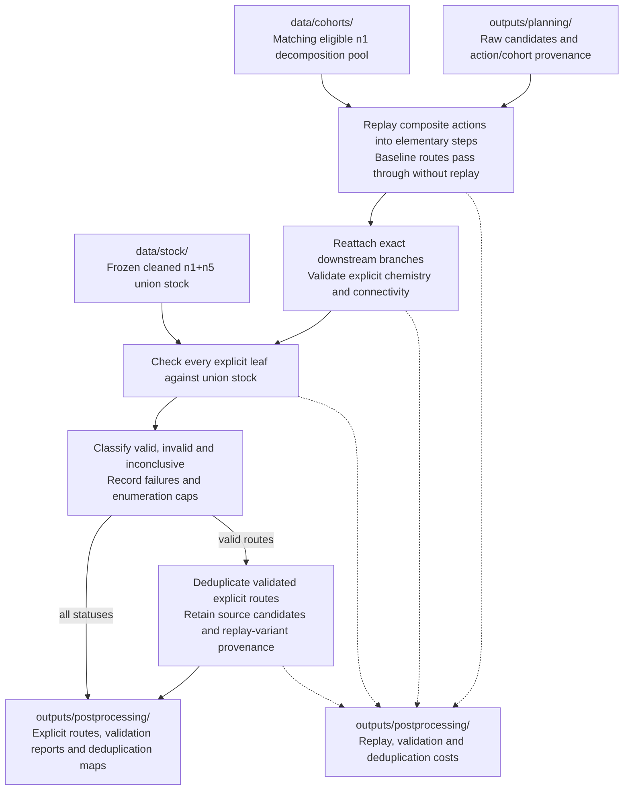

# Post-processing workflow

This stage turns MCTS candidates into explicit, validated routes. Strict replay,
reattachment, validation, and the post-processing runner remain TODOs. See
[PLAN.md](../../PLAN.md#cost-validation-and-diversity).

Baseline routes undergo the same explicit chemistry and stock checks. Composite
replay uses the matching cohort's eligible n1 support; n5 reference routes do not
supply decomposition alternatives. Deduplication removes duplicate explicit
routes caused by atom mappings or different macro encodings, while preserving
the distinction between independently discovered routes and replay variants.

Only fully validated routes whose leaves are all in stock count as solved.
Non-stock leaves exposed by replay cannot count as solved; immediate failure
versus a separately recorded and charged completion search remains an open
decision. Truncated or unresolved validation must remain visible in the reports.
Preserve raw planning outputs and write derived results to
[outputs/postprocessing/](../../outputs/README.md). Next: [analysis](analysis.md).
