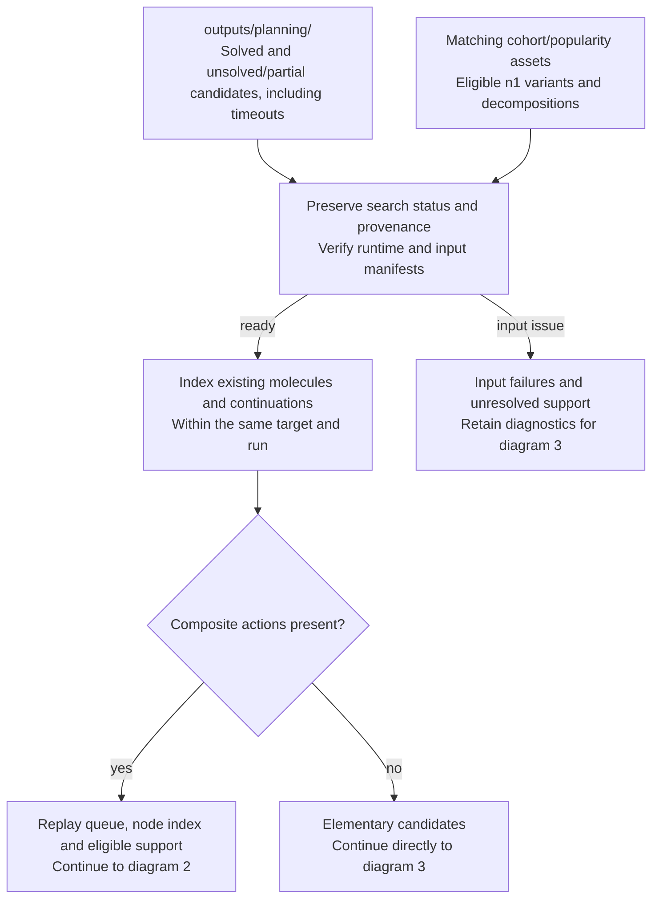
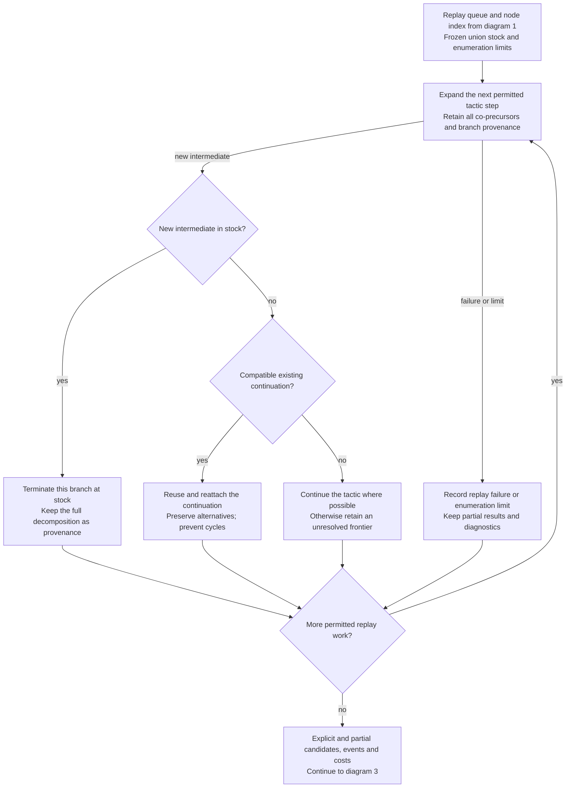
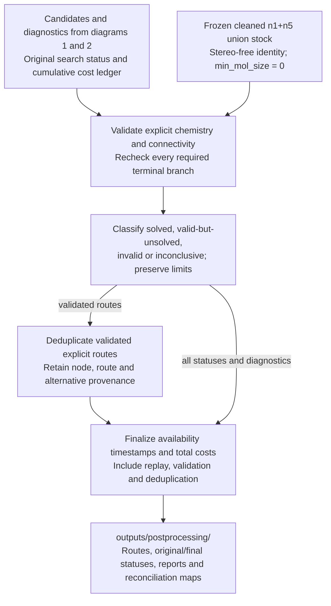

# Post-processing workflow

This stage is split into three diagrams: prepare candidates, replay and reconcile,
then validate and finalize. The route-level replay integration, reattachment,
validation and runner remain TODOs. See
[PLAN.md](../../PLAN.md#cost-validation-and-diversity) and the
[evaluation specifications](../EVALUATION.md).

## 1. Prepare candidates

Include retained branches from unsuccessful searches; the planner's solved flag
must not gate replay. Keep frontier states, parent links, atom correspondence and
action provenance. Resolve composite support only for candidates that need it;
baseline routes enter the same final validation without a composite-support
requirement. Use eligible n1 support for the matching vocabulary, never n5 source
routes. Load the frozen union stock and preserve the upstream call/time ledger.

Keep baseline and hybrid searches isolated. An identity match indexes possible
reuse within a run; it does not authorize sharing MCTS state or value statistics.

## 2. Replay and reconcile intermediates

Repeat the stock and compatibility checks for each new intermediate during
replay. A stock hit terminates only that branch; all required co-precursors and
other pending branches remain. Queue remaining composite steps, including those
in reused continuations, within the frozen limits. Retain unresolved non-stock
frontiers when no permitted continuation exists.

Match against both ordinary single-step and composite-generated nodes. Use the
agreed stereo-free identity to find candidates, then verify executable graph and
atom-correspondence compatibility before reattachment. InChI equality alone is
insufficient. Preserve precursor multiplicity, parent context and alternative
valid continuations; prevent cycles without merging entire search states.

Record branch reuse and stock termination separately from original search
success. Failed alternatives and limits remain visible alongside surviving
candidates. Count all replay, reconciliation and stock-check time; reused search
work retains its original cost. Any new completion search or neural inference
requires the separately defined budget and accounting protocol.

## 3. Validate and finalize

Only validated routes whose required leaves are all in stock count as solved.
Validate stock-shortened routes independently of their full original tactic.
Keep valid-but-unsolved partial candidates distinct from invalid or inconclusive
ones; an unresolved non-stock branch cannot be counted as a solution.

Deduplicate atom-map variants and equivalent macro/single-step encodings while
retaining source candidates and decomposition provenance. A route may be present
in both original single-step results and replay results without being two unique
routes. Preserve unsolved-to-solved transitions through stock termination or
compatible continuation reuse.

All candidates, including baseline routes, receive the same explicit chemistry
and stock checks. Record when a validated route actually becomes available;
do not backdate success to macro discovery before replay. Preserve raw planning
outputs and write derived routes, statuses, cost records and audits to
[outputs/postprocessing/](../../outputs/README.md). Exact source RouteCGR recovery
and supplementary SB-CGR diversity belong to the next stage: [analysis](analysis.md).
