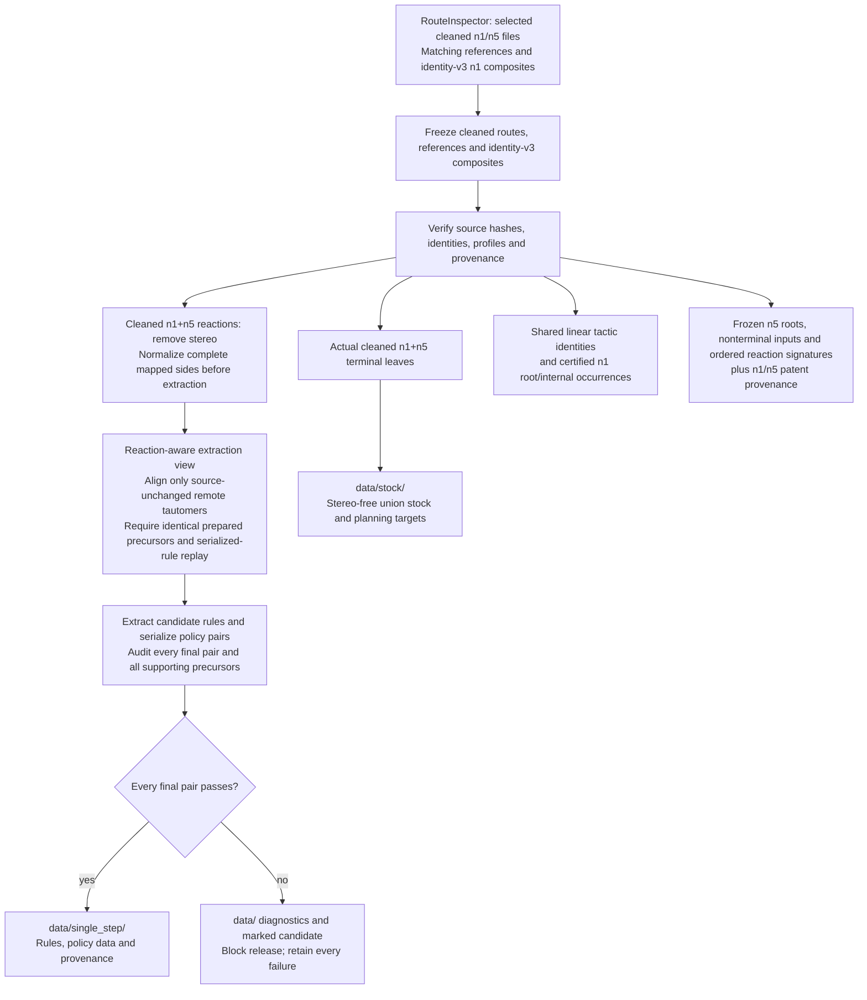
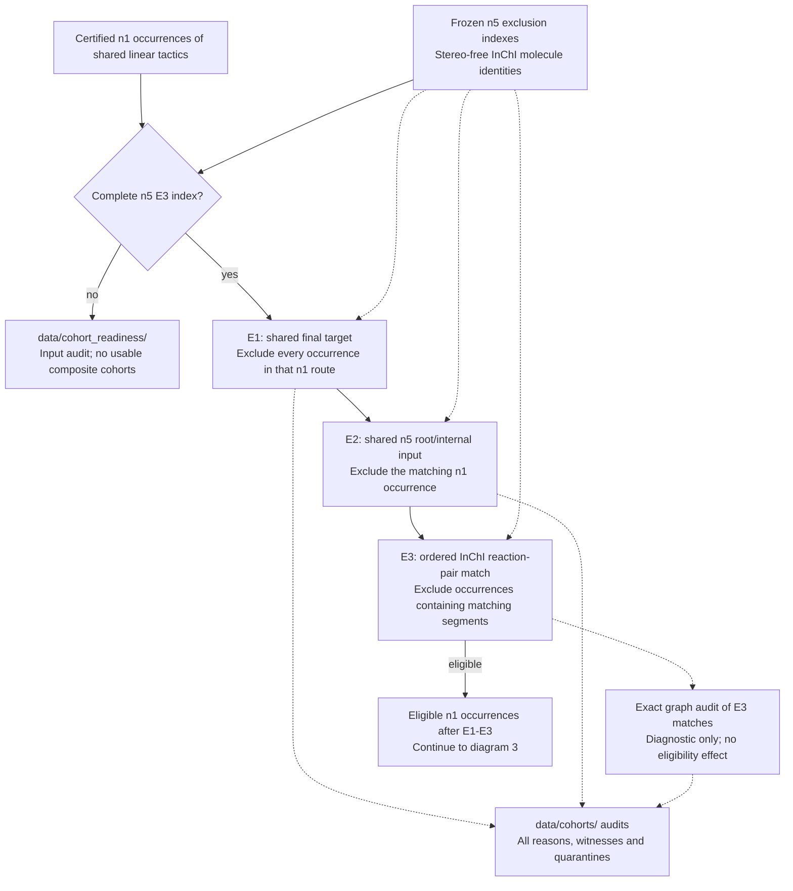
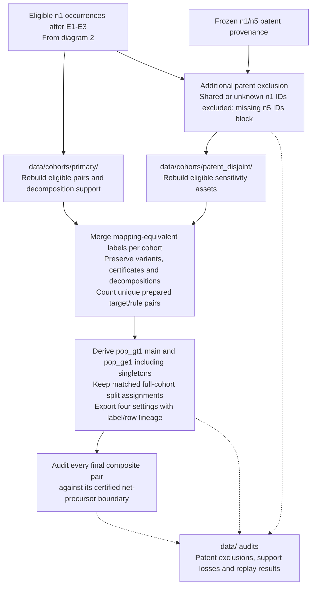

# Preparation workflow

Preparation is split into three diagrams: shared data preparation, primary
occurrence exclusions, then composite cohorts and vocabulary audits. The export and cohort-selection tools are implemented;
production inputs are the existing standalone cleaned n1/n5 files selected by the user.
Library refreshing remains in RouteInspector. See [PLAN.md](../../PLAN.md#primary-occurrence-exclusions)
for exact exclusions and [preparation commands](../PREPARATION.md) for adapters.

## 1. Freeze inputs and prepare shared data

Shared tactics, certified occurrences, and frozen comparison indexes feed the
second diagram. Composite exclusions leave the single-step corpus and stock intact.

## 2. Apply the primary occurrence exclusions

Evaluate all three predicates for audit purposes; the sequence does not discard
later reasons after the first match. Quarantine unresolved eligibility checks.
Graph audit results are match, different or unresolved; failures are diagnostic
only. Abstract tactic overlap alone is not E3: an ordered InChI reaction-pair
match embedded within a larger n1 occurrence also triggers E3. Incomplete n5
comparison indexes block both cohorts.

The retained occurrences feed both cohort definitions in the next diagram.

## 3. Build composite cohorts, vocabularies and audits

Rebuild all composite-derived support using only retained n1 occurrences, drop
unsupported tactics, and report lost n5 coverage. Unresolved n5 patent provenance
blocks the sensitivity cohort. Blocked cohorts have no trainable assets.

The popularity layer is planned, not yet exported. Count support after merging
within each eligible n1 cohort, before its grouped holdout. Freeze full-cohort
groups and assignments, then filter merged labels while preserving eligible
variants/decompositions. See the
[experiment matrix](../../PLAN.md#composite-popularity-experiment).

The earlier three n5 mismatch findings were false positives; the InChI-based
reference audit under `data/cohort_readiness_inchi/` passes all 10,000 routes.
The public release contains full occurrence filtering and supersedes the historical
source-error diagnosis; see [cohort results](../COHORT_RELEASE.md) and
[readiness](../DATASET_READINESS.md).

All preparation products remain under [data/](../../data/README.md). Next:
[training](training.md).
