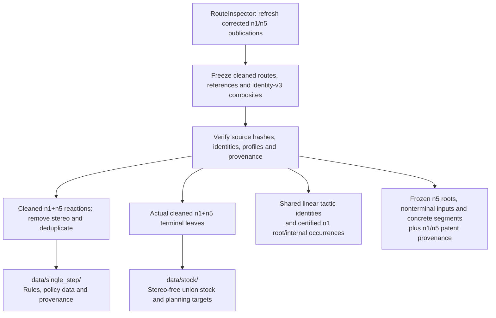
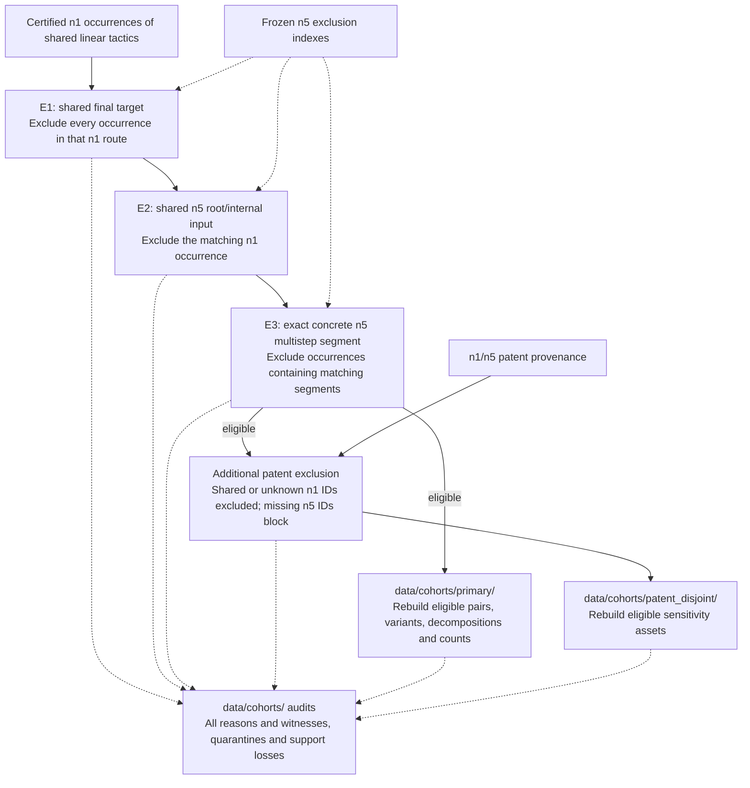

# Preparation workflow

Preparation is split into two diagrams: shared data preparation, then composite
cohort filtering. The export and cohort-selection tools are implemented;
production execution still awaits matching refreshed source publications.
Library refreshing remains in RouteInspector. See [PLAN.md](../../PLAN.md#primary-occurrence-exclusions)
for exact exclusions and [preparation commands](../PREPARATION.md) for adapters.

## 1. Freeze inputs and prepare shared data

Shared tactics, certified occurrences, and frozen comparison indexes feed the
second diagram. Composite exclusions leave the single-step corpus and stock intact.

## 2. Filter n1 occurrences and publish composite cohorts

Evaluate all three predicates for audit purposes; the sequence does not discard
later reasons after the first match. Quarantine unresolved comparisons. Abstract
tactic overlap alone is not E3; an exact concrete n5 segment embedded within a
larger n1 occurrence also triggers E3. Rebuild all composite-derived support using
only retained n1 occurrences, drop unsupported tactics, and report lost n5 coverage.
Blocked sensitivity cohorts publish audits without trainable assets.

All preparation products remain under [data/](../../data/README.md). Next:
[training](training.md).
