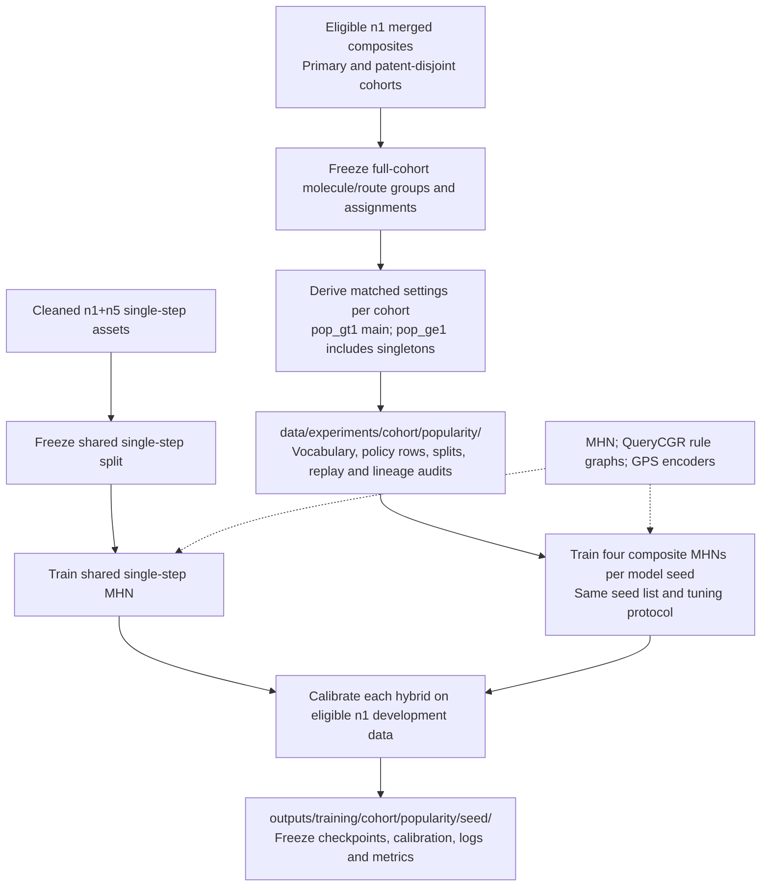

# Training workflow

Grouped splitting and seed-controlled MHN training are implemented. The new
popularity exports and matched split derivation, production training, calibration
and hybrid implementation remain TODOs. See [training commands](../TRAINING.md)
and [experiment matrix](../../PLAN.md#composite-popularity-experiment).

Popularity counts unique prepared target/merged-rule pairs from eligible n1,
before its holdout. Preserve assignments when deriving >1; verify train support
and report common validation pairs. No n5 composite examples enter training,
validation or calibration. Single-step exposure to n5 is deliberate.

Prepared data and frozen splits stay in [data/](../../data/README.md). Each
checkpoint must match its ordered vocabulary and eligible decomposition pool.
Results belong in [outputs/training/](../../outputs/README.md).
Next: [planning](planning.md).
