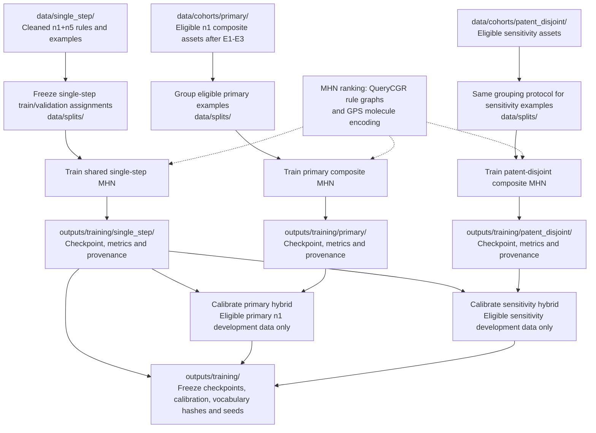

# Training workflow

Native TSV preparation, cohort filtering, grouped splitting, and seed-controlled
MHN training are implemented. Production split review, full training, calibration,
and the SynPlanner hybrid implementation remain TODOs. See
[training commands](../TRAINING.md), [PLAN.md](../../PLAN.md), and
[open decisions](../../QUESTIONS.md).

Single-step exposure to n5 is deliberate. No n5 composite examples enter composite
training, validation, or calibration. Grouping keeps identical motif inputs and all linked source routes together;
optional patent grouping adds patent links and requires complete provenance. The hybrid allocation
within 50 remains open; 40/10 is a proposal. Keep each checkpoint tied to its
ordered vocabulary and eligible decomposition pool in `data/`.

Prepared data and frozen splits stay in [data/](../../data/README.md). Training
results and calibration belong in [outputs/training/](../../outputs/README.md).
Next: [planning](planning.md).
